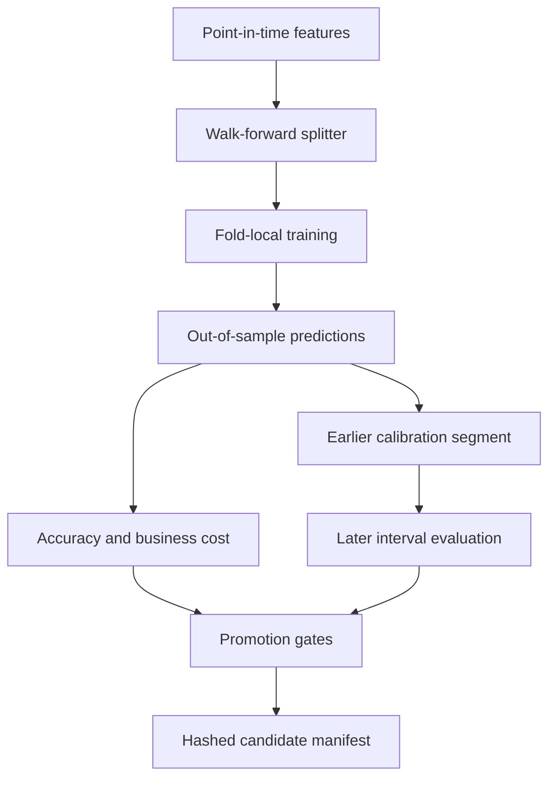

# Financial Time-Series Forecasting Platform

A correctness-first reference platform for **time-ordered model evaluation, probabilistic uncertainty and governed model promotion**. It includes a deterministic synthetic market for reproducible verification and a validated CSV boundary for evaluating external observations without weakening the temporal contract.

This is no longer a notebook-shaped “train an LSTM and plot the test set” project. The package makes temporal boundaries, baselines, uncertainty calibration, business costs and release decisions explicit and testable.

## What is implemented

| Concern | Implementation | Failure guarded |
|---|---|---|
| Data ingestion | Ordered CSV validation, point-in-time price/action/FX revision selection with SHA-256 lineage | Silent sorting, future revisions/actions/rates and untraceable inputs |
| Validation | Expanding or capped rolling walk-forward folds | Random split leakage |
| Label overlap | Horizon-aware purge contract | Training labels reaching into the test period |
| Target contract | Immutable horizon/specification digest | Target construction drifting from the purge policy |
| Baselines | Zero return, historical mean, seasonal naive | Beating no meaningful comparator |
| Candidates | Standardized ridge and histogram gradient boosting | Preprocessing fit outside each fold |
| Point accuracy | MAE, RMSE, sMAPE, MASE, direction | Single-metric storytelling |
| Model comparison | Circular moving-block bootstrap of paired loss differences | IID resampling that erases short-range dependence |
| Decision economics | Asymmetric under/over-forecast cost and action cost | Statistically better but operationally worse model |
| Uncertainty | Split conformal absolute-residual intervals | Uncalibrated confidence claims |
| Governance | MAE improvement, fold-win and cost gates | Automatic promotion from one aggregate score |
| Reproducibility | Canonical SHA-256 model manifest | Untraceable candidate artifact |
| Delivery | Wheel, CLI, FastAPI and non-root container | Source-tree-only demo |

## Evaluation topology



The split contract uses exclusive end offsets and checks both invariants for every fold:

```text
train_end + purge_gap == test_start
latest_train_label_end = train_end - 1 + label_horizon < test_start
```

`ForecastTargetSpec` constructs the forward simple return for a bounded 1–252 observation
horizon and emits canonical SHA-256 specification and target-value evidence. `BacktestRunner` can
require that evidence and rejects a missing, modified or policy-mismatched target before any model is fitted.
The splitter's `label_horizon` must equal the target horizon and `purge_gap` must be at least that
horizon. The default one-step target therefore uses a one-observation gap.

Models are constructed and fitted inside the fold loop. The test index must be unique and increasing; overlapping test windows are rejected instead of silently double-counting forecasts.

## Package map

```text
finforecast/
├── backtest.py     # fold-local model execution and aggregation
├── baselines.py    # protocol and deterministic benchmark models
├── corporate_actions.py # point-in-time split/dividend/delisting evidence
├── fx.py                # governed point-in-time direct/bridged FX selection
├── data.py         # validated CSV loading and normalized data identity
├── domain.py       # fold, interval and promotion domain records
├── evidence.py     # reproducible end-to-end verification artifact
├── features.py     # shifted/rolling point-in-time features
├── intervals.py    # finite-sample split conformal calibration
├── metrics.py      # point, probabilistic and business metrics
├── models.py       # model factories; no fitted global instances
├── registry.py     # multi-gate promotion and hashed manifest
└── splits.py       # expanding/rolling splitter with purge gap
```

`ForecastExperiment` remains as a compatibility facade for the earlier public API and enforces the
default one-step target evidence. New integrations should compose `ForecastTargetSpec`,
`WalkForwardSplitter` and `BacktestRunner` directly.

## Run the governed experiment

```bash
python -m venv .venv
source .venv/bin/activate
pip install -e '.[test]'
finforecast --evidence --rows 900 --seed 42 --output artifacts
```

The command writes:

- `forecast_evidence.json`: dataset identity, every fold boundary, aggregate metrics, interval evaluation, promotion decision and claim limitations;
- `candidate_manifest.json`: canonical SHA-256 fingerprint over the candidate, data configuration, metrics and decision.

CI produces the evidence twice and requires a byte-for-byte match. It then builds a wheel, installs it in a clean environment and produces evidence outside the checkout. The artifact uploaded by CI is computed, not hand-written.

## Evaluate an external CSV

The default schema is `timestamp,close,volume`. Timestamps must already be unique and increasing; close values must be finite and positive; volume must be finite and non-negative. The loader normalizes timestamps to UTC and records a semantic SHA-256 fingerprint in every result and evidence manifest.

```bash
finforecast --csv prices.csv --output artifacts/market
finforecast --csv prices.csv --evidence --output artifacts/market-evidence
```

Column names are configurable with `--timestamp-column`, `--close-column` and `--volume-column`. Use `--no-volume` for a close-only file. The CLI requires at least 320 selected observations so the 60-period features, minimum training window and out-of-sample evaluation all remain non-empty.

### Point-in-time revision snapshots

Revision-bearing vendor exports can additionally declare `available_at` and `revision_id`. Supply a
timezone-aware `--as-of` cutoff to select, for every observation timestamp, only the latest revision
available by that instant:

```bash
finforecast \
  --csv price-vintages.csv \
  --as-of 2026-06-30T23:59:59Z \
  --evidence \
  --output artifacts/market-vintage
```

Rows must be ordered by `(timestamp, available_at)`. The loader rejects availability before the
observation, ambiguous availability times, reused revision IDs and malformed IDs. Evidence records
the cutoff, selected/eligible/excluded counts, the selected revision digest and a full lineage digest
over all supplied revisions. This makes the local selection reproducible and prevents a later vendor
revision from entering an earlier snapshot. It cannot establish that vendor availability timestamps
are truthful; that remains a source-governance requirement. Custom column names use
`--available-at-column` and `--revision-column`.

### Point-in-time corporate-action adjustments

Back-adjusted vendor histories can leak a split, cash dividend, or delisting payout that was not yet
known or effective at a historical evaluation cutoff. Supply a revision-bearing action feed
together with the same `--as-of` value:

```bash
finforecast \
  --csv price-vintages.csv \
  --as-of 2026-06-30T23:59:59Z \
  --corporate-actions-csv action-vintages.csv \
  --symbol ACME \
  --price-currency USD \
  --fx-rates-csv fx-vintages.csv \
  --fx-bridge-currency GBP \
  --max-fx-age-hours 168 \
  --max-fx-leg-skew-hours 1 \
  --evidence \
  --output artifacts/total-return-adjusted
```

Core columns are `action_id,symbol,action_type,effective_at,available_at,revision_id`. Split rows add
`split_ratio`; `cash_dividend` and `cash_delisting` rows add `cash_amount,currency` and require
`--price-currency`. Unused type-specific fields must be empty. Rows must be ordered by
`(action_id, available_at)` and timestamps must carry explicit timezones.

When a selected cash-action currency differs from the price currency, `--fx-rates-csv` is mandatory.
The revision-bearing FX feed contains
`base_currency,quote_currency,observed_at,available_at,revision_id,rate`, where `rate` means one
unit of base currency in quote currency. Direct pairs are preferred. A directed two-leg route can
be enabled only through an explicit, repeatable `--fx-bridge-currency`; implicit inversion and
undeclared currencies remain rejected. Rows are ordered by pair, observation time and availability.
The latest revision known at `--as-of` is selected for each observation. Dividend conversion uses
the latest FX observation at or before its governed reference close; delisting conversion uses the
latest observation at or before the delisting effective timestamp. `--max-fx-age-hours` applies to
every leg independently. For a two-leg route, `--max-fx-leg-skew-hours` also limits the difference
between leg observation timestamps, preventing individually fresh but asynchronous quotes from being
combined. Multiple fresh bridge routes, excessive timestamp skew, incomplete routes and unused
supplied pairs fail closed instead of silently choosing or accepting excess market data.

Only the latest revision known at the cutoff is selected; an announced but not-yet-effective action
is committed to the snapshot but cannot adjust prices. For each effective split, earlier raw closes
are divided by the new-to-old share ratio and volumes are multiplied by it. For a cash dividend,
the latest selected close strictly before the effective timestamp is the governed reference price:

```text
converted_cash_amount = cash_amount * product(route_leg_rates)  # foreign dividends only
factor = (reference_close - converted_cash_amount) / reference_close
adjusted_historical_close = raw_historical_close * factor
```

For an effective `cash_delisting`, the selected payout is converted into the declared price currency
under the same point-in-time FX policy and appended at `effective_at` as a synthetic terminal close.
An explicitly declared zero payout records zero recovery without requiring a meaningless FX quote.
If volume exists, terminal volume is zero. A delisting must be the only effective delisting, the last
effective corporate action, and strictly later than every supplied market observation. These
invariants prevent post-delisting prices or later actions from silently extending a dead instrument:

```text
terminal_close = cash_amount * product(route_leg_rates)  # foreign payout only
terminal_volume = 0
```

Ordinary market ingestion still rejects zero prices. Feature construction admits a zero only when
the point-in-time corporate-action snapshot marks the single final observation as an explicit zero-
recovery delisting. The resulting final supervised target is exactly `-1.0`; an earlier or unbound
zero remains invalid.

The original cash amount/currency, converted price-currency amount, selected FX route and revisions,
and governed reference timestamp/close are committed to the selected-action digest. Dividend
evidence additionally binds its adjustment factor; delisting evidence binds its synthetic terminal
close. Dividend volume is unchanged, while a synthetic delisting endpoint has zero volume. Dataset
metadata reports raw and adjusted observation counts separately. FX evidence binds the complete
supplied rate lineage, cutoff selection counts, pair direction, declared bridge set, per-route
observed skew, freshness policy and synchronization budget. Multiple actions at exactly the same
effective timestamp are rejected because their adjustment basis is ambiguous. Evidence also binds
raw and adjusted market fingerprints, complete revision lineage, and exclusion counts. The input
must contain raw, unadjusted observations; this contract cannot detect a vendor that silently
supplies adjusted prices or false action/FX availability timestamps. It supports at most one
explicitly declared two-leg directed route per conversion and does not model market calendars,
implicit inversion, withholding tax or execution spreads. Timestamp proximity reduces asynchronous-
quote risk but does not prove that the two markets were simultaneously liquid.

### Revision-aware delisting settlement

A cash delisting can alternatively bind multiple delayed or partial distributions through
`--settlement-ledger-csv`. In this mode the corporate-action row is only a closeout anchor and must
declare zero cash in the instrument's price currency, preventing the direct payout and ledger from
being double counted:

```bash
finforecast \
  --csv price-vintages.csv \
  --as-of 2026-06-30T23:59:59Z \
  --corporate-actions-csv delisting-vintages.csv \
  --settlement-ledger-csv settlement-vintages.csv \
  --settlement-fx-rates-csv settlement-fx-vintages.csv \
  --settlement-rate-curve-csv settlement-rate-curves.csv \
  --settlement-calendar-json settlement-calendar.json \
  --settlement-max-rate-age-hours 24 \
  --symbol ACME \
  --price-currency USD \
  --evidence \
  --output artifacts/settlement-adjusted
```

The settlement feed has the strict schema
`event_id,symbol,event_type,effective_at,available_at,revision_id,cash_amount,currency`.
`cash_flow` rows must be positive, use uppercase ISO 4217 currencies, occur strictly after the final
market observation, and be effective no later than closeout. A single `closeout` row must carry zero
cash, no currency, and exactly match the delisting effective timestamp. The latest revision known at
`--as-of` is selected per event; unavailable revisions cannot rewrite the historical recovery target.

Foreign cash flows require the separate `--settlement-fx-rates-csv` feed. The standard FX CSV is not
silently reused: settlement conversion has independent `--settlement-max-fx-age-hours`,
`--settlement-max-fx-leg-skew-hours`, and repeatable `--settlement-fx-bridge-currency` policy. Each
cash flow selects the latest admissible direct or declared two-leg route at that cash flow's own
`effective_at`; a later closeout-date quote cannot be reused for an earlier payment.

An optional, separately governed `--settlement-rate-curve-csv` carries converted payments to the
closeout timestamp. Its strict schema is
`curve_id,currency,calendar_id,calendar_sha256,roll_convention,day_count,observed_at,available_at,revision_id,tenor_days,zero_rate`.
The feed must contain one price-currency curve with complete tenor shapes and one day-count policy
across revisions. `day_count` is restricted to `ACT/365F` or `ACT/360`. An unadjusted curve uses
`calendar_id=NONE`, an empty `calendar_sha256`, and `roll_convention=UNADJUSTED`. Any other calendar
requires `--settlement-calendar-json`; its canonical content digest and identifier must exactly match
the curve declarations. Reviewed roll conventions are `FOLLOWING`, `PRECEDING`, and
`MODIFIED_FOLLOWING`. For each pre-closeout payment,
the latest curve observation at or before that payment is selected from revisions known by
`--as-of`; rates are linearly interpolated in tenor without extrapolation. Curve observations older
than `--settlement-max-rate-age-hours` fail closed. The terminal close uses the curve's declared
actual-day convention and continuous compounding:

```text
converted_i = cash_amount_i * product(route_leg_rates_at_effective_at_i)
adjusted_start_i, adjusted_end_i = calendar_roll(original timestamps)
year_fraction_i = adjusted_elapsed_days_i / (360 or 365)
terminal_close = sum(converted_i * exp(zero_rate_i(tenor_i) * year_fraction_i))
```

Evidence binds selection counts, total cash, closeout time, selected-event digest, complete lineage
digest, FX revision lineage and route metadata, rate-curve lineage, interpolation brackets,
day-count and compounding conventions, and the resulting market fingerprint. Unknown
columns, mixed symbols, event-type changes, missing or non-terminal closeout, undeclared/unused FX
routes, stale or future-only quotes/curves, mixed or unsupported day counts, calendar digest or
coverage mismatches, unsupported roll rules, curve extrapolation, pre-delisting cash flows, and a
non-zero direct delisting payout fail closed. With no curve, the backward-compatible factor is one.
The calendar artifact has two strict, backward-compatible schemas. Version 1 requires
`timezone=UTC`. Version 2 requires a canonical IANA zone plus `tzdata_version=2026.6`; the runtime
dependency is pinned to that exact release and zone files are loaded directly from the package,
never from the host operating system. Both schemas require a stable ID and revision, inclusive
coverage dates, sorted weekday numbers, and sorted ISO holiday dates. Local-time rolling preserves
the wall-clock time across offset changes, and fails closed if the adjusted time is ambiguous or
nonexistent at a daylight-saving transition. Curve selection still uses the original cash-flow
timestamp; rolling can change only the accrual interval and cannot admit a future curve observation.
Evidence binds the artifact digest, revision, timezone, tzdata release, roll convention, and both
adjusted timestamps.

Before changing the pinned tzdata dependency, export a behavior manifest with the old runtime and
compare it with the candidate runtime:

```python
from pathlib import Path

from finforecast.business_calendar import load_business_calendar
from finforecast.calendar_migration import (
    build_calendar_behavior_manifest,
    dump_calendar_behavior_manifest,
    load_calendar_behavior_manifest,
    require_calendar_migration,
)

# Run before the dependency change and retain this reviewed baseline.
baseline = build_calendar_behavior_manifest(load_business_calendar("settlement-calendar.json"))
Path("calendar-behavior-baseline.json").write_bytes(dump_calendar_behavior_manifest(baseline))

# Run after the dependency and calendar revision change.
candidate = build_calendar_behavior_manifest(load_business_calendar("settlement-calendar.json"))
report = require_calendar_migration(
    load_calendar_behavior_manifest("calendar-behavior-baseline.json"),
    candidate,
    approved_changed_dates=["2027-04-01"],
)
```

The manifest covers every date in the artifact at 00:00, 06:00, 12:00, and 18:00 UTC, committing
the resulting local timestamp, UTC offset, business-day classification, and all supported roll
outcomes into per-day SHA-256 digests. Coverage is bounded to 3,660 days. The migration gate
requires the same calendar identity, timezone, coverage, probe schedule, holiday/weekend rules,
and a different revision and tzdata version. Its observed behavior-change dates must exactly equal
the sorted review allowlist: both an unapproved change and an expected-but-missing change fail
closed. The report binds both manifests, the reviewed dates, findings, and decision into a
deterministic evidence digest.

This is a bounded regression screen rather than a proof that all local wall-clock instants are
unchanged; transition behavior between the four daily probes may require targeted golden vectors.
Manifest digests provide integrity checks, not signer authentication, and the audit does not prove
that the supplied holiday rules or timezone-law source are economically authoritative.

This contract does not model withholding tax, execution spreads, non-cash consideration, exchange
session hours, jurisdiction-specific observance rules beyond the supplied holiday set, ad-hoc
closures, collateral/funding basis, or distributions announced after the governed cutoff.
Vendor availability timestamps, curve construction, and ISO currency labels remain external
governance dependencies.

The leap-day golden vectors in `tests/fixtures/settlement_day_count_vectors.json` were precomputed
at 50-digit precision with decimal arithmetic. They cross-check both supported year fractions and
continuous-compounding factors independently of the binary-float production path.

## Promotion policy

A candidate becomes champion only if every configured gate passes:

1. relative MAE improvement over the baseline reaches the threshold;
2. it wins the required fraction of individual walk-forward folds;
3. its asymmetric business cost does not regress beyond the allowed ratio.

A rejection is a valid output and includes machine-readable reasons such as `insufficient_fold_win_rate` or `business_cost_regression`. The demo does not force a flattering result.

The compatibility report compares gradient boosting with the zero-return baseline using a circular moving-block bootstrap. Blocks preserve local ordering in paired loss differences; the report records the method, block size and resample count. It is explicitly a bootstrap diagnostic, not a Diebold–Mariano test.

## Probabilistic forecast boundary

The conformal calibrator learns an absolute-residual radius from an **earlier out-of-sample prediction segment**. Coverage and interval width are then measured on the later segment. The implementation uses the finite-sample conformal rank `ceil((n + 1) * coverage)` rather than a casual percentile call.

This establishes an explicit uncertainty contract for either data source. Exchangeability can fail under financial regime change, so production use would additionally require rolling recalibration and conditional coverage monitoring.

## API and container

```bash
uvicorn app.api:app --reload
curl http://localhost:8000/health
curl 'http://localhost:8000/demo?rows=900&seed=42&cost_bps=5'

docker build -t financial-time-series-forecasting .
docker run --rm -p 8000:8000 financial-time-series-forecasting
```

The release image installs the built wheel and runs as a non-root user. The API is intentionally a deterministic demonstration boundary, not a market-data ingestion service.

The `/demo` boundary validates `rows` (320–2,000) and `cost_bps` (0–1,000) before starting model work, so malformed or unexpectedly expensive requests receive a `422` response. Library entry points also reject non-finite values, duplicate or unordered timestamps, missing volume timestamps and invalid target matrices before fitting.

## Verification

```bash
ruff check .
ruff format --check .
pytest -q
```

The regression suite covers temporal isolation, rolling windows, invalid and overlapping folds, baseline lifecycle, edge-case metric semantics, conformal ranking, asymmetric cost, independent promotion gates, manifest determinism, API compatibility and complete evidence reproduction.

## Claims and non-claims

This repository demonstrates evaluation and release engineering. It does **not** claim alpha,
profitability or readiness for live capital. The CSV boundary validates structure, not economic
correctness: the snapshot boundary enforces declared availability but cannot verify vendor claims.
Production data still needs vendor guarantees, stateful multi-payment delisting treatment, market
calendars, execution delay, slippage/impact, nested historical tuning and live coverage monitoring.

Those are explicit boundaries because a credible financial ML project should make invalid
conclusions difficult—not merely make charts attractive.
