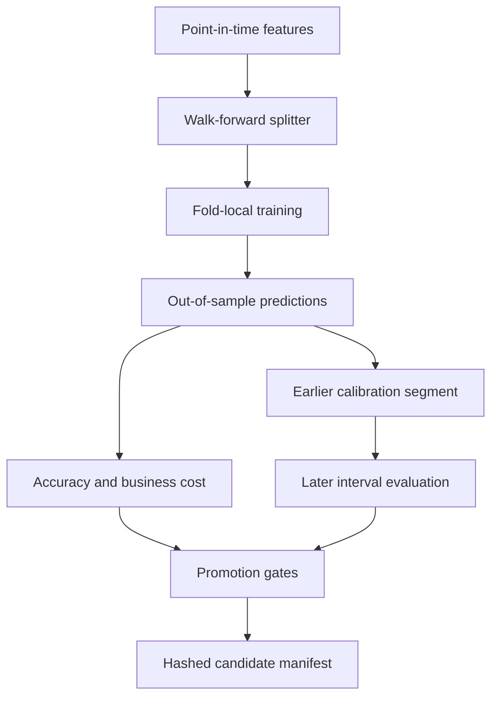

# Financial Time-Series Forecasting Platform

A correctness-first reference platform for **time-ordered model evaluation, probabilistic uncertainty and governed model promotion**. It includes a deterministic synthetic market for reproducible verification and a validated CSV boundary for evaluating external observations without weakening the temporal contract.

This is no longer a notebook-shaped “train an LSTM and plot the test set” project. The package makes temporal boundaries, baselines, uncertainty calibration, business costs and release decisions explicit and testable.

## What is implemented

| Concern | Implementation | Failure guarded |
|---|---|---|
| Data ingestion | Ordered CSV validation, point-in-time price and split-revision selection with SHA-256 lineage | Silent sorting, future revisions/actions and untraceable inputs |
| Validation | Expanding or capped rolling walk-forward folds | Random split leakage |
| Label overlap | Horizon-aware purge contract | Training labels reaching into the test period |
| Target contract | Immutable horizon/specification digest | Target construction drifting from the purge policy |
| Baselines | Zero return, historical mean, seasonal naive | Beating no meaningful comparator |
| Candidates | Standardized ridge and histogram gradient boosting | Preprocessing fit outside each fold |
| Point accuracy | MAE, RMSE, sMAPE, MASE, direction | Single-metric storytelling |
| Model comparison | Circular moving-block bootstrap of paired loss differences | IID resampling that erases short-range dependence |
| Decision economics | Asymmetric under/over-forecast cost and action cost | Statistically better but operationally worse model |
| Uncertainty | Split conformal absolute-residual intervals | Uncalibrated confidence claims |
| Governance | MAE improvement, fold-win and cost gates | Automatic promotion from one aggregate score |
| Reproducibility | Canonical SHA-256 model manifest | Untraceable candidate artifact |
| Delivery | Wheel, CLI, FastAPI and non-root container | Source-tree-only demo |

## Evaluation topology



The split contract uses exclusive end offsets and checks both invariants for every fold:

```text
train_end + purge_gap == test_start
latest_train_label_end = train_end - 1 + label_horizon < test_start
```

`ForecastTargetSpec` constructs the forward simple return for a bounded 1–252 observation
horizon and emits canonical SHA-256 specification and target-value evidence. `BacktestRunner` can
require that evidence and rejects a missing, modified or policy-mismatched target before any model is fitted.
The splitter's `label_horizon` must equal the target horizon and `purge_gap` must be at least that
horizon. The default one-step target therefore uses a one-observation gap.

Models are constructed and fitted inside the fold loop. The test index must be unique and increasing; overlapping test windows are rejected instead of silently double-counting forecasts.

## Package map

```text
finforecast/
├── backtest.py     # fold-local model execution and aggregation
├── baselines.py    # protocol and deterministic benchmark models
├── corporate_actions.py # point-in-time split selection and adjustment evidence
├── data.py         # validated CSV loading and normalized data identity
├── domain.py       # fold, interval and promotion domain records
├── evidence.py     # reproducible end-to-end verification artifact
├── features.py     # shifted/rolling point-in-time features
├── intervals.py    # finite-sample split conformal calibration
├── metrics.py      # point, probabilistic and business metrics
├── models.py       # model factories; no fitted global instances
├── registry.py     # multi-gate promotion and hashed manifest
└── splits.py       # expanding/rolling splitter with purge gap
```

`ForecastExperiment` remains as a compatibility facade for the earlier public API and enforces the
default one-step target evidence. New integrations should compose `ForecastTargetSpec`,
`WalkForwardSplitter` and `BacktestRunner` directly.

## Run the governed experiment

```bash
python -m venv .venv
source .venv/bin/activate
pip install -e '.[test]'
finforecast --evidence --rows 900 --seed 42 --output artifacts
```

The command writes:

- `forecast_evidence.json`: dataset identity, every fold boundary, aggregate metrics, interval evaluation, promotion decision and claim limitations;
- `candidate_manifest.json`: canonical SHA-256 fingerprint over the candidate, data configuration, metrics and decision.

CI produces the evidence twice and requires a byte-for-byte match. It then builds a wheel, installs it in a clean environment and produces evidence outside the checkout. The artifact uploaded by CI is computed, not hand-written.

## Evaluate an external CSV

The default schema is `timestamp,close,volume`. Timestamps must already be unique and increasing; close values must be finite and positive; volume must be finite and non-negative. The loader normalizes timestamps to UTC and records a semantic SHA-256 fingerprint in every result and evidence manifest.

```bash
finforecast --csv prices.csv --output artifacts/market
finforecast --csv prices.csv --evidence --output artifacts/market-evidence
```

Column names are configurable with `--timestamp-column`, `--close-column` and `--volume-column`. Use `--no-volume` for a close-only file. The CLI requires at least 320 selected observations so the 60-period features, minimum training window and out-of-sample evaluation all remain non-empty.

### Point-in-time revision snapshots

Revision-bearing vendor exports can additionally declare `available_at` and `revision_id`. Supply a
timezone-aware `--as-of` cutoff to select, for every observation timestamp, only the latest revision
available by that instant:

```bash
finforecast \
  --csv price-vintages.csv \
  --as-of 2026-06-30T23:59:59Z \
  --evidence \
  --output artifacts/market-vintage
```

Rows must be ordered by `(timestamp, available_at)`. The loader rejects availability before the
observation, ambiguous availability times, reused revision IDs and malformed IDs. Evidence records
the cutoff, selected/eligible/excluded counts, the selected revision digest and a full lineage digest
over all supplied revisions. This makes the local selection reproducible and prevents a later vendor
revision from entering an earlier snapshot. It cannot establish that vendor availability timestamps
are truthful; that remains a source-governance requirement. Custom column names use
`--available-at-column` and `--revision-column`.

### Point-in-time split adjustments

Back-adjusted vendor histories can leak a split that was not yet known or effective at a historical
evaluation cutoff. Supply a revision-bearing split feed together with the same `--as-of` value:

```bash
finforecast \
  --csv price-vintages.csv \
  --as-of 2026-06-30T23:59:59Z \
  --corporate-actions-csv split-vintages.csv \
  --symbol ACME \
  --evidence \
  --output artifacts/split-adjusted
```

The split schema is `action_id,symbol,action_type,effective_at,available_at,revision_id,split_ratio`.
Rows must be ordered by `(action_id, available_at)` and timestamps must carry explicit timezones.
Only the latest revision known at the cutoff is selected; an announced but not-yet-effective action
is committed to the snapshot but cannot adjust prices. For each effective split, earlier raw closes
are divided by the new-to-old share ratio and volumes are multiplied by it. Evidence binds the raw
and adjusted market fingerprints, selected action digest, complete action lineage, and exclusion
counts. The input must contain raw, unadjusted observations; this contract cannot detect a vendor
that silently supplies already-adjusted prices or a false announcement timestamp.

## Promotion policy

A candidate becomes champion only if every configured gate passes:

1. relative MAE improvement over the baseline reaches the threshold;
2. it wins the required fraction of individual walk-forward folds;
3. its asymmetric business cost does not regress beyond the allowed ratio.

A rejection is a valid output and includes machine-readable reasons such as `insufficient_fold_win_rate` or `business_cost_regression`. The demo does not force a flattering result.

The compatibility report compares gradient boosting with the zero-return baseline using a circular moving-block bootstrap. Blocks preserve local ordering in paired loss differences; the report records the method, block size and resample count. It is explicitly a bootstrap diagnostic, not a Diebold–Mariano test.

## Probabilistic forecast boundary

The conformal calibrator learns an absolute-residual radius from an **earlier out-of-sample prediction segment**. Coverage and interval width are then measured on the later segment. The implementation uses the finite-sample conformal rank `ceil((n + 1) * coverage)` rather than a casual percentile call.

This establishes an explicit uncertainty contract for either data source. Exchangeability can fail under financial regime change, so production use would additionally require rolling recalibration and conditional coverage monitoring.

## API and container

```bash
uvicorn app.api:app --reload
curl http://localhost:8000/health
curl 'http://localhost:8000/demo?rows=900&seed=42&cost_bps=5'

docker build -t financial-time-series-forecasting .
docker run --rm -p 8000:8000 financial-time-series-forecasting
```

The release image installs the built wheel and runs as a non-root user. The API is intentionally a deterministic demonstration boundary, not a market-data ingestion service.

The `/demo` boundary validates `rows` (320–2,000) and `cost_bps` (0–1,000) before starting model work, so malformed or unexpectedly expensive requests receive a `422` response. Library entry points also reject non-finite values, duplicate or unordered timestamps, missing volume timestamps and invalid target matrices before fitting.

## Verification

```bash
ruff check .
ruff format --check .
pytest -q
```

The regression suite covers temporal isolation, rolling windows, invalid and overlapping folds, baseline lifecycle, edge-case metric semantics, conformal ranking, asymmetric cost, independent promotion gates, manifest determinism, API compatibility and complete evidence reproduction.

## Claims and non-claims

This repository demonstrates evaluation and release engineering. It does **not** claim alpha,
profitability or readiness for live capital. The CSV boundary validates structure, not economic
correctness: the snapshot boundary enforces declared availability but cannot verify vendor claims.
Production data still needs vendor guarantees, dividend and delisting treatment, market calendars,
execution delay, slippage/impact, nested historical tuning
and live coverage monitoring.

Those are explicit boundaries because a credible financial ML project should make invalid
conclusions difficult—not merely make charts attractive.
